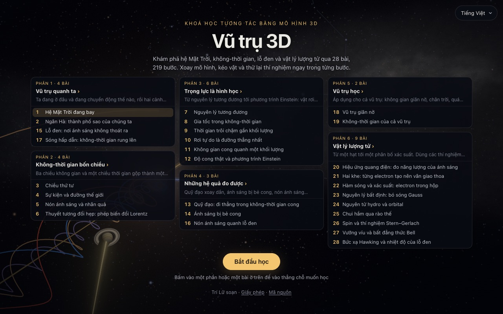
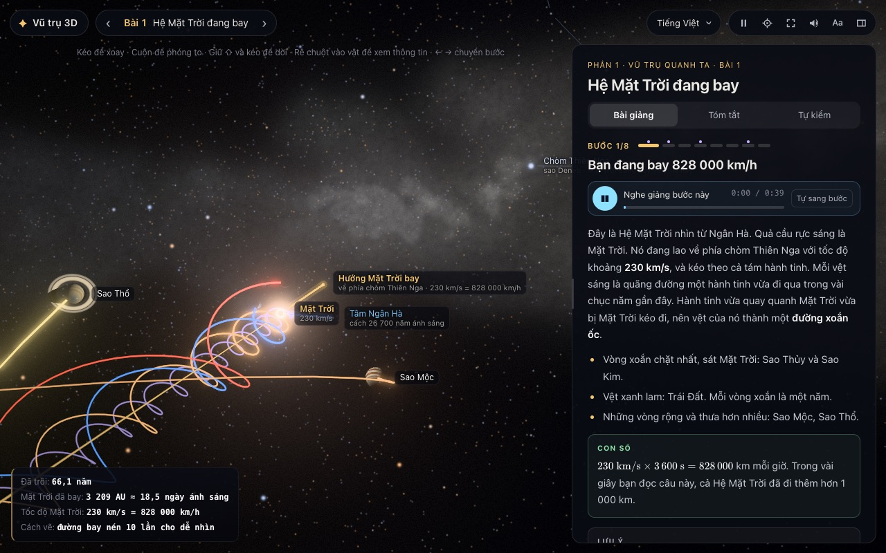
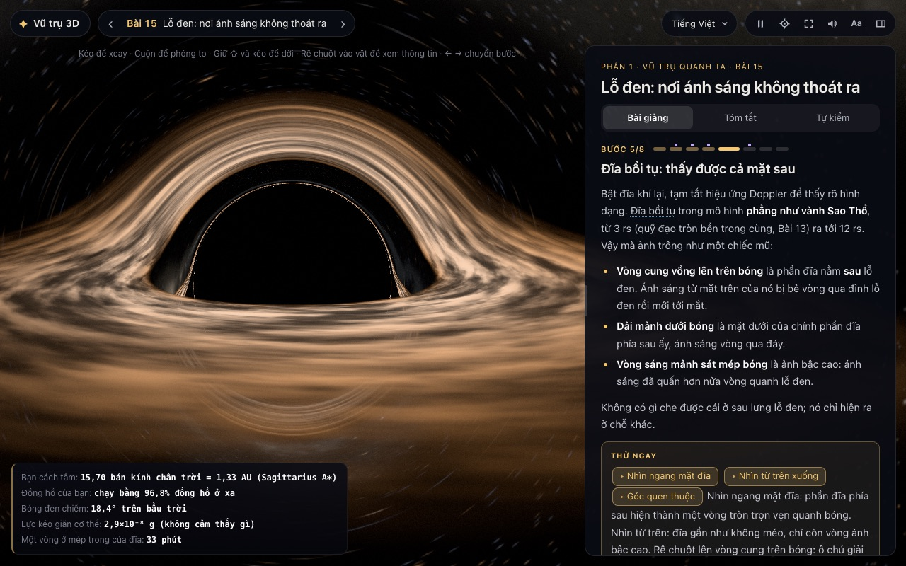
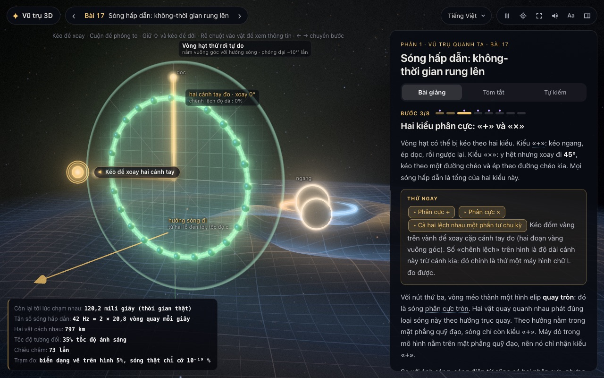
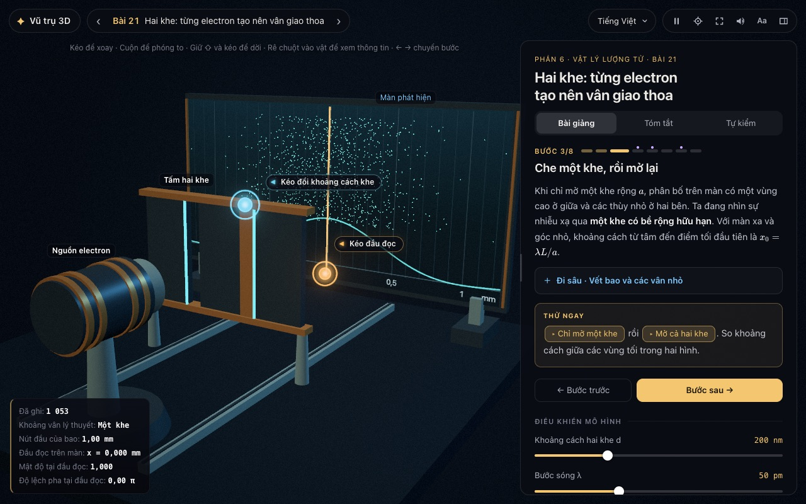

# 3D Universe (Vũ trụ 3D)

[Tiếng Việt](README.md) · **English** · [简体中文](README.zh-CN.md) · [日本語](README.ja.md)

An interactive physics course built around 3D models: the Solar System, spacetime, special and general relativity, black holes, gravitational waves, cosmology and quantum physics. There are 28 lessons, available in Vietnamese, English, Simplified Chinese and Japanese. Every lesson is a live simulation running in your browser, paired with a step-by-step lecture: as you read each step, the model changes to match it. You can rotate and zoom, drag objects, change parameters and rerun experiments without leaving the lesson.

**Try it in your browser: <https://trilu.edu.vn/vu-tru-3d/>** No installation, no account.



| | |
|---|---|
|  |  |
|  |  |

## What's inside

Six parts, 28 lessons. Lesson numbers never change (lectures refer to each other by number), but the menu shows the two most spectacular lessons first.

- **Part 1 · The universe around us**: 1 The Solar System in flight · 2 The Milky Way: our city of stars · 15 Black holes: where light cannot escape · 17 Gravitational waves: ripples in spacetime
- **Part 2 · Four-dimensional spacetime**: 3 The fourth dimension · 4 Events and world lines · 5 Light cones and causality · 6 Special relativity: the Lorentz transformation
- **Part 3 · Gravity is geometry**: 7 The equivalence principle · 8 Acceleration in spacetime · 9 Time runs slower near mass · 10 Free fall is the straightest path · 11 Curved space around a mass · 12 True curvature and Einstein's equation
- **Part 4 · Measurable consequences**: 13 Orbits: moving straight through curved spacetime · 14 Light bends · 16 Light cones around a black hole
- **Part 5 · Cosmology**: 18 The expanding universe · 19 The spacetime of the whole universe
- **Part 6 · Quantum physics**: 20 The photoelectric effect: measuring the energy of light · 21 Double slits: building interference fringes one electron at a time · 22 Wave function and probability: an electron in a box · 23 Uncertainty: a Gaussian wave packet · 24 Hydrogen and its orbitals · 25 Tunneling through a potential barrier · 26 Spin and the Stern–Gerlach experiment · 27 Entanglement and Bell's inequality · 28 Hawking radiation and black-hole temperature

Each lesson has three tabs: **Lesson** (the steps, with "Try it" buttons that drive the model), **Summary** (key ideas, numbers worth remembering, common misconceptions) and **Self-check** (questions with worked answers). Numbers come from measurements and papers cited in the lesson itself. Lesson 1 already has Vietnamese narration; the other lessons are being recorded. A few lessons (currently 10–14, 16, 18 and 19) are still being translated and show Vietnamese text for now.

<details>
<summary><b>Keyboard shortcuts</b></summary>

| Key | Action |
|---|---|
| ← → | previous / next step |
| ⇧← ⇧→ (or Page Up / Page Down) | previous / next lesson |
| Space | pause or resume the model |
| R | reset the view |
| F | full screen |
| B | show or hide the lecture panel |
| M | lesson list |
| G | glossary and formula sheet |
| N | play the narration for this step (where available) |
| S | sound on / off |
| Esc | close the lesson list or glossary |
| Enter | start (on the welcome screen) |

Mouse: drag to rotate, scroll to zoom, hold ⇧ and drag to pan, hover an object for details. On a phone: one finger rotates, two fingers zoom and pan.

Deep links: `?bai=15` (by lesson number), `?canh=lo-den&buoc=3` (by lesson id and step), `?lang=en` (`vi`, `en`, `zh-CN`, `ja`).

</details>

<details>
<summary><b>For developers: building from source, project layout, adding a lesson, narration</b></summary>

## Building from source

You need Node.js 18 or newer.

```bash
npm install          # three.js, KaTeX, esbuild… (build-time only)
npm run build        # → dist/index.html: one self-contained HTML file; double-click to open, works offline
npm run web          # → dist/web/: the version for a web server, with narration files, icons and share tags
npm run kiem         # run the physics test suites (no browser needed)
```

`dist/index.html` runs straight from disk but has no narration, because the audio files live outside the page. To try the web build locally:

```bash
python3 -m http.server 8000 -d dist/web     # then open http://localhost:8000/
```

Or let a script check it for you (headless Chrome, muted; serves the page under `/vu-tru-3d/`, tries all four languages on desktop and phone sizes, and plays the narration): `node cong-cu/thu-ban-web.mjs dist/web`.

The web build only uses relative paths, so it works from any sub-folder (for example `/vu-tru-3d/`). To change the address used in the share tags: `node cong-cu/dung-web.mjs --goc-web https://your-domain/path/`.

Useful `build.mjs` options: `--tho` (no minification), `--chi lo-den,song-hap-dan` (bundle only some lessons, for quick builds), `--ra <folder>` (write somewhere other than `dist/`).

### macOS app

With the Xcode Command Line Tools installed (`xcode-select --install`):

```bash
bash dong-goi-app.sh            # build the page, compile the Swift/WKWebView shell, install to ~/Applications
bash dong-goi-app.sh --kiem     # also let the app step through every lesson; install only if nothing fails
```

The app is ad-hoc signed and not notarized, so it is meant for the machine that built it.

### Headless browser checks

These need Google Chrome and run it headless with audio muted.

```bash
bash kiem-tra/tu-kiem.sh dist/index.html                                    # walk every step, press every button, report errors
bash kiem-tra/chup.sh dist/index.html shot.png "canh=lo-den&buoc=3&tua=4"   # screenshot one step
```

`tua=4` runs the simulation for 4 seconds before the screenshot (headless browsers barely animate otherwise).

## Project layout

The code is written in Vietnamese: file, folder and most identifier names are Vietnamese words without diacritics (`canh` = scene/lesson, `khung` = framework, `vat-ly` = physics, `ngon-ngu` = languages, `kiem-tra` = tests, `cong-cu` = tools, `giong-doc` = narration).

```
src/
  main.js, index.html, style.css   start-up, page skeleton, styles
  khung/        shared framework: render loop, lecture panel, UI, synthesized sound, interaction, rendering
  canh/         one file per lesson (<lesson-id>.js): the 3D model and the Vietnamese lecture
  vat-ly/       pure physics (no drawing), each with its own tests
  noi-dung/     course outline, narration scripts, glossary, quantum lessons' lectures
  ngon-ngu/     English, Chinese and Japanese translations (one JSON file per lesson) and the language picker
  du-lieu/      packed sky data (stars, Milky Way, constellations)
app-mac/        macOS shell (Swift) and icon
giong-doc/      narration audio and its index
cong-cu/        web build, narration generator, text extraction for translators, sky-data packer
kiem-tra/       physics tests (kiem-*.mjs), self-check and screenshots via headless Chrome
tai-lieu/anh/   README images
tai-nguyen-web/ favicon and share image for the web build
build.mjs       bundles everything into one HTML file
```

## Adding a lesson

1. Create `src/canh/<lesson-id>.js` exporting an object with `id`, `ten` (title), `moTa` (one-line description), `yChinh` (key idea), `mayAnh` (camera), `baiGiang` (lecture: `mucTieu`, `buoc`, `congThuc`, `cauHoi`, `docThem`, `thuatNgu`), `conSo`, `hieuDung`, `nguon` (sources) and `tao(app)`, which builds the scene and returns `{ scene, capNhat(dt), hud() }`. Each step in `baiGiang.buoc` has `ten`, `noiDung` (marked-up text) and `vao(scene, app)`, which puts the model into that step's state. Any existing lesson is a good template.
2. Add the id to `SO_BAI` (numbering) and to a part in `KHOA_HOC` in `src/noi-dung/khoa-hoc.js`.
3. Lecture markup (documented at the top of `src/khung/bai-giang.js`): `**bold**`, `*emphasis*`, `$inline math$`, `$$display math$$`, `### subheading`, lists, tables, callouts `> [Ví dụ] …`, collapsible blocks `+++ Đi sâu: …`, buttons `[[Label|name]]` that call the step's `nut.<name>`, and glossary terms `{{term}}`.
4. Put the physics in `src/vat-ly/` with a test file `kiem-tra/kiem-<lesson-id>.mjs` (using `kiem-tra/khung-kiem.mjs`).
5. Translations: `node cong-cu/xuat-chu-bai.mjs` extracts the Vietnamese strings into `src/ngon-ngu/vi/`; translations go in files of the same name under `src/ngon-ngu/en/`, `zh-CN/` and `ja/`. Untranslated strings fall back to Vietnamese.
6. Quick build of just your lesson: `node build.mjs --tho --chi <lesson-id>`, then `bash kiem-tra/tu-kiem.sh dist/index.html "canh=<lesson-id>&tukiem=1"`, and screenshot each step to check the visuals.

## Narration

Narration scripts live in `src/loi-doc/vi/*.json`. The audio is generated with `cong-cu/tao-giong-doc-google.py` (Google Cloud Text-to-Speech, Chirp 3 HD voices; you need your own Google Cloud project, `gcloud` and FFmpeg). Only steps whose text changed are regenerated, and `giong-doc/danh-sach.json` is rewritten; the page reads that index at build time.

</details>

## Bugs and suggestions

Please open an [issue](https://github.com/luminhtri0-hash/vu-tru-3d/issues) with the lesson and step number, the language, your browser and device, and a screenshot if you can. For physics or data errors, a source helps a lot. Pull requests are welcome; for a new lesson, please open an issue first so we can discuss it.

## Credits and licenses

Lessons, code and models by Trí Lữ.

- **Source code**: MIT, see [`LICENSE`](LICENSE).
- **Lesson content** (lectures, narration scripts, translations, voice recordings, images): CC BY-NC-SA 4.0. [`LICENSE-CONTENT.md`](LICENSE-CONTENT.md) lists exactly which files that covers. Feel free to teach with it, show it in class or translate it for non-commercial use, with attribution.
- **Third-party libraries, fonts and data** (three.js, KaTeX, Hipparcos/XHIP star data, Natural Earth coastlines…): see [`NOTICE.md`](NOTICE.md).

© 2026 Trí Lữ.
