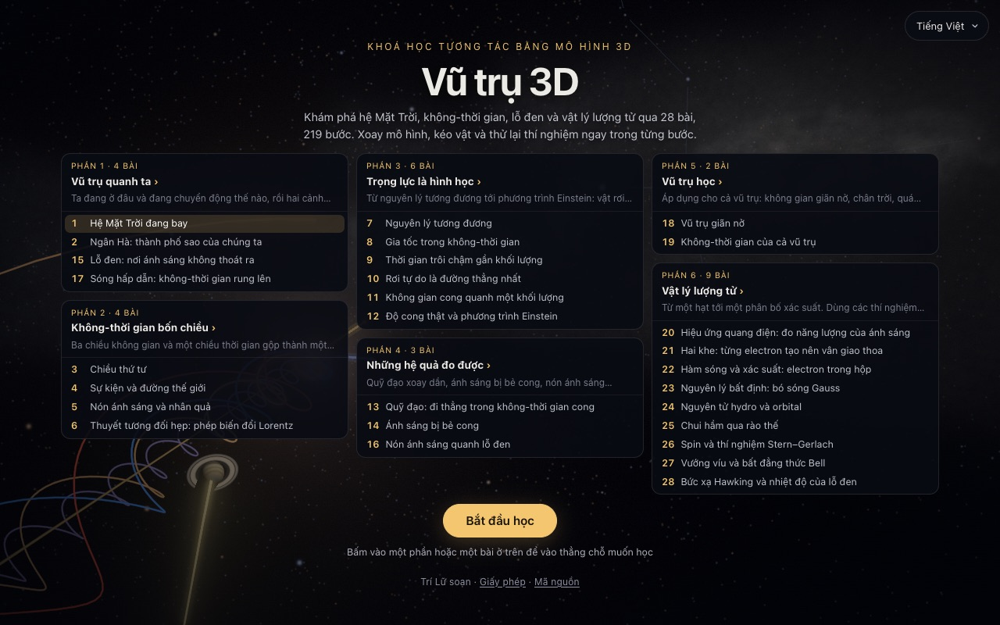
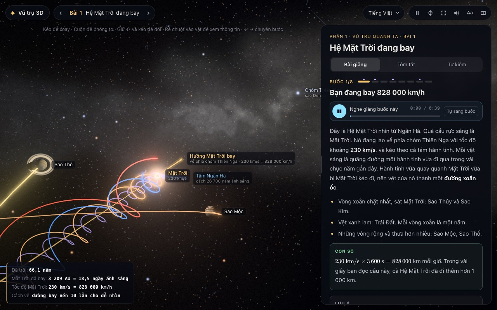
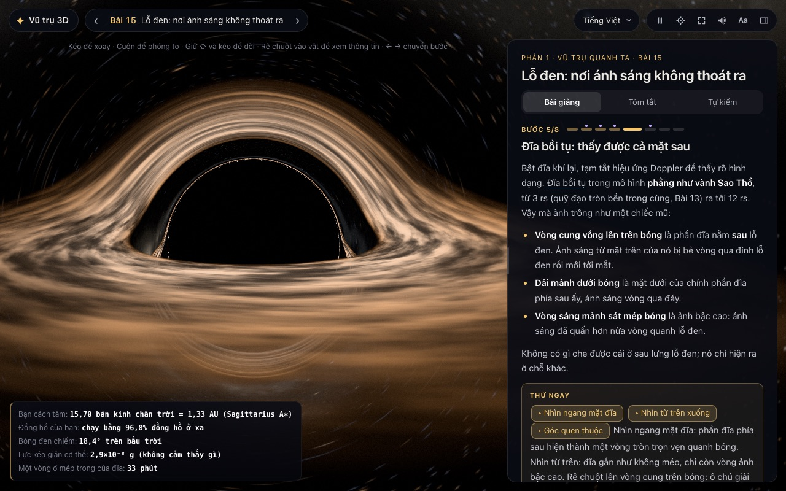
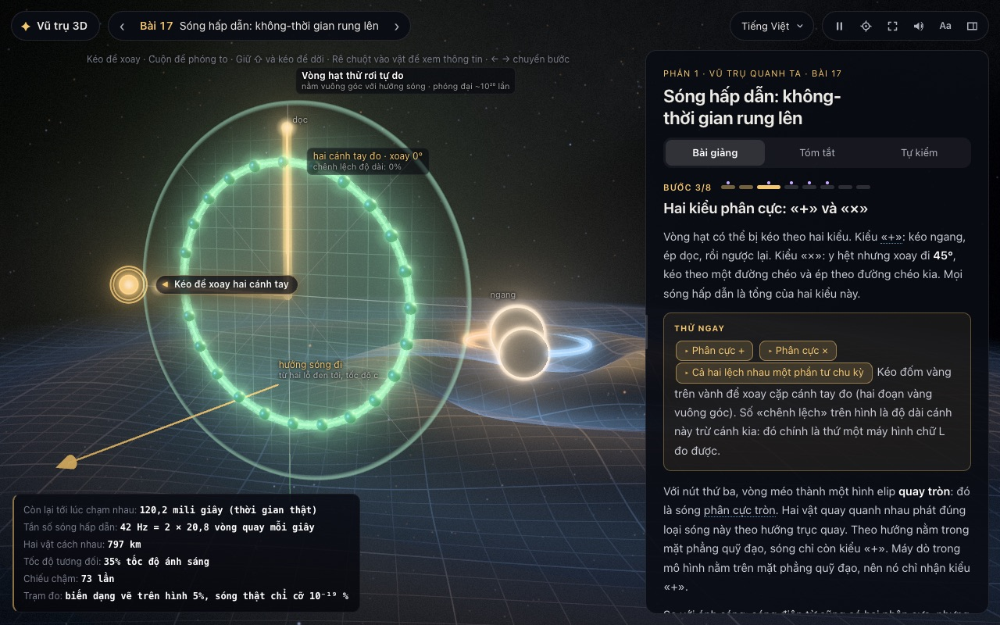
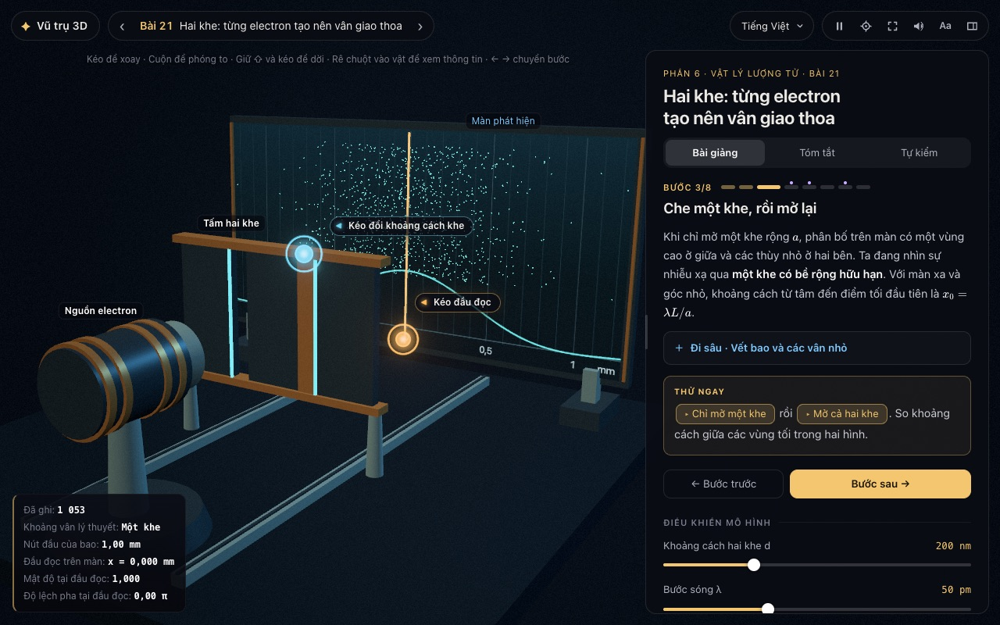

# 3D宇宙（Vũ trụ 3D）

[Tiếng Việt](README.md) · [English](README.en.md) · [简体中文](README.zh-CN.md) · **日本語**

3Dモデルを動かしながら学ぶ物理の講座です。太陽系、時空、特殊・一般相対性理論、ブラックホール、重力波、宇宙論、量子物理までを全28課で扱います。表示言語はベトナム語、英語、簡体字中国語、日本語の4つです。どの課もブラウザ上で動くシミュレーションと、ステップごとの解説がセットになっていて、解説を読み進めるとモデルもその場面に切り替わります。回転・拡大、物の移動、パラメータの変更、実験のやり直しが、課の中でそのままできます。

**ブラウザですぐ使えます：<https://trilu.edu.vn/vu-tru-3d/>** インストールもアカウント登録も不要です。



| | |
|---|---|
|  |  |
|  |  |

## 内容

6部構成、全28課です。課の番号は固定です（解説の中で番号を使って他の課を参照しているため）。目次では、特に見ごたえのある2課を先頭に並べています。

- **第1部 · 身のまわりの宇宙**：1 移動する太陽系 · 2 天の川銀河：私たちが住む星の街 · 15 ブラックホール：光も脱出できない場所 · 17 重力波：時空が振動する
- **第2部 · 四次元時空**：3 第四の次元 · 4 事象と世界線 · 5 光円錐と因果律 · 6 特殊相対性理論：ローレンツ変換
- **第3部 · 重力の幾何学**：7 等価原理 · 8 時空における加速度 · 9 質量の近くでは時間がゆっくり進む · 10 自由落下はいちばんまっすぐな道 · 11 質量のまわりの曲がった空間 · 12 本当の曲率とアインシュタイン方程式
- **第4部 · 観測で確かめられる現象**：13 軌道：曲がった時空をまっすぐ進む · 14 曲がる光 · 16 ブラックホールのまわりの光円錐
- **第5部 · 宇宙論**：18 膨張する宇宙 · 19 宇宙全体の時空
- **第6部 · 量子物理学**：20 光電効果：光のエネルギーを測る · 21 二重スリット：電子を一つずつ重ねて干渉縞をつくる · 22 波動関数と確率：箱の中の電子 · 23 不確定性原理：ガウス波束 · 24 水素原子と軌道 · 25 ポテンシャル障壁を通り抜ける · 26 スピンとシュテルン＝ゲルラッハの実験 · 27 量子もつれとベルの不等式 · 28 ホーキング放射とブラックホールの温度

各課には3つのタブがあります。**解説**（ステップごとの説明。「試してみよう」ボタンでモデルを直接動かせます）、**まとめ**（要点、覚えておきたい数値、よくある誤解）、**理解度チェック**（解説つきの問題）です。課の中の数値は、その課に出典を明記した観測や論文に基づいています。第1課にはベトナム語の音声解説がついており、ほかの課も順次収録中です。いくつかの課（現在は第10～14、16、18、19課）は翻訳作業中のため、当面はベトナム語で表示されます。

## キーボードショートカット

| キー | 動作 |
|---|---|
| ← → | 前のステップ / 次のステップ |
| ⇧← ⇧→（または PageUp / PageDown） | 前の課 / 次の課 |
| スペース | モデルの一時停止・再開 |
| R | 最初の視点に戻す |
| F | 全画面表示 |
| B | 講義パネルの表示・非表示 |
| M | 目次 |
| G | 用語集と公式集 |
| N | このステップの音声解説を再生（音声がある場合） |
| S | 音のオン・オフ |
| Esc | 目次・用語集を閉じる |
| Enter | （スタート画面で）学習を始める |

マウス：ドラッグで回転、ホイールで拡大・縮小、⇧を押しながらドラッグで移動、物にカーソルを合わせると説明が出ます。スマートフォンでは、1本指で回転、2本指で拡大・縮小と移動です。

URLで直接開くこともできます：`?bai=15`（課の番号）、`?canh=lo-den&buoc=3`（課のIDとステップ）、`?lang=ja`（`vi`、`en`、`zh-CN`、`ja`）。

## ソースからのビルド

Node.js 18 以降が必要です。

```bash
npm install          # three.js、KaTeX、esbuild などをインストール（ビルド時のみ使用）
npm run build        # → dist/index.html：単体で動くHTMLファイル1つ。ダブルクリックで開け、オフラインでも動きます
npm run web          # → dist/web/：Webサーバーに置く版。音声ファイル、アイコン、共有用タグつき
npm run kiem         # 物理計算のテストを実行（ブラウザ不要）
```

`dist/index.html` はディスクから直接開けますが、音声ファイルがページの外にあるため音声解説は流れません。Web版を手元で試すには：

```bash
python3 -m http.server 8000 -d dist/web     # http://localhost:8000/ を開く
```

Web版は相対パスだけを使っているので、どのサブフォルダ（例：`/vu-tru-3d/`）に置いても動きます。共有用タグのURLは `node cong-cu/dung-web.mjs --goc-web https://your-domain/path/` で変更できます。

`build.mjs` の主なオプション：`--tho`（圧縮しない。デバッグ向け）、`--chi lo-den,song-hap-dan`（一部の課だけをまとめて高速ビルド）、`--ra <フォルダ>`（`dist/` 以外に出力）。

### macOS アプリ

Xcode Command Line Tools（`xcode-select --install`）を入れたうえで：

```bash
bash dong-goi-app.sh            # ページをビルドし、Swift + WKWebView の外枠をコンパイルして ~/Applications にインストール
bash dong-goi-app.sh --kiem     # ビルド後、アプリに全課を自動で通させ、エラーがなければインストール
```

アプリはその場での仮署名（ad-hoc）のみで、Apple の公証は受けていません。ビルドしたMacで使う前提です。

### ヘッドレスブラウザでのチェック

Google Chrome が必要です。画面を出さず、音声もミュートして動かします。

```bash
bash kiem-tra/tu-kiem.sh dist/index.html                                    # 全ステップを自動で進め、全ボタンを押してエラーを報告
bash kiem-tra/chup.sh dist/index.html shot.png "canh=lo-den&buoc=3&tua=4"   # 1ステップのスクリーンショット
```

`tua=4` はモデルを4秒動かしてから撮影する指定です（ヘッドレスブラウザはそのままだとほとんどアニメーションしません）。

## フォルダ構成

コードはベトナム語で書かれています。ファイル名・フォルダ名・多くの識別子は声調記号を外したベトナム語です（`canh` = シーン／課、`khung` = フレームワーク、`vat-ly` = 物理、`ngon-ngu` = 言語、`kiem-tra` = テスト、`cong-cu` = ツール、`giong-doc` = 音声解説）。

```
src/
  main.js, index.html, style.css   起動処理、ページの骨組み、スタイル
  khung/        共通部分：描画ループ、講義パネル、UI、合成音、インタラクション、レンダリング
  canh/         1課1ファイル（<課のID>.js）：3Dモデルとベトナム語の講義
  vat-ly/       物理計算のみ（描画なし）。それぞれテストつき
  noi-dung/     講座の目次、音声原稿、用語集、量子分野の講義
  ngon-ngu/     英語・中国語・日本語の翻訳（課ごとのJSON）と言語の切り替え
  du-lieu/      まとめ済みの星空データ（恒星、天の川、星座）
app-mac/        macOS の外枠（Swift）とアイコン
giong-doc/      音声解説とその一覧
cong-cu/        Web版のビルド、音声の生成、翻訳用テキストの抽出、星空データの作成
kiem-tra/       物理テスト（kiem-*.mjs）、ヘッドレス Chrome による自動チェックと撮影
tai-lieu/anh/   README の画像
tai-nguyen-web/ Web版のアイコンと共有用画像
build.mjs       すべてを1つのHTMLファイルにまとめる
```

## 課を追加するには

1. `src/canh/<課のID>.js` を作り、`id`、`ten`（題名）、`moTa`（1行の説明）、`yChinh`（要点）、`mayAnh`（カメラ）、`baiGiang`（講義：`mucTieu`、`buoc`、`congThuc`、`cauHoi`、`docThem`、`thuatNgu`）、`conSo`、`hieuDung`、`nguon`（出典）と、シーンを組み立てて `{ scene, capNhat(dt), hud() }` を返す `tao(app)` を持つオブジェクトを default export します。`baiGiang.buoc` の各ステップは `ten`、`noiDung`（記法つきテキスト）、そしてモデルをそのステップの状態にする `vao(シーン, app)` を持ちます。既存のどの課もひな形として使えます。
2. `src/noi-dung/khoa-hoc.js` の `SO_BAI`（課の番号）と、`KHOA_HOC` のいずれかの部にIDを追加します。
3. 講義テキストの記法（`src/khung/bai-giang.js` の冒頭に説明があります）：`**太字**`、`*強調*`、`$インライン数式$`、`$$別行立て数式$$`、`### 小見出し`、箇条書き、表、囲み `> [Ví dụ] …`、折りたたみ `+++ Đi sâu: …`、そのステップの `nut.<名前>` を呼ぶボタン `[[表示文字|名前]]`、用語 `{{用語}}`。
4. 物理計算は `src/vat-ly/` に置き、テスト `kiem-tra/kiem-<課のID>.mjs`（`kiem-tra/khung-kiem.mjs` を使用）を書きます。
5. 翻訳：`node cong-cu/xuat-chu-bai.mjs` でベトナム語のテキストを `src/ngon-ngu/vi/` に書き出し、訳文は同じファイル名で `src/ngon-ngu/en/`、`zh-CN/`、`ja/` に置きます。未翻訳の文はベトナム語のまま表示されます。
6. 新しい課だけをビルドすると速く確認できます：`node build.mjs --tho --chi <課のID>` のあと `bash kiem-tra/tu-kiem.sh dist/index.html "canh=<課のID>&tukiem=1"`。各ステップを撮影して見た目も確かめてください。

## 音声解説

各ステップの読み上げ原稿は `src/noi-dung/loi-doc.js` にあります。音声は `cong-cu/tao-giong-doc-google.py` で作ります（Google Cloud Text-to-Speech の Chirp 3 HD 音声。ご自身の Google Cloud プロジェクト、`gcloud`、FFmpeg が必要です）。原稿が変わったステップだけを作り直し、`giong-doc/danh-sach.json` を更新します。ページはビルド時にこの一覧を読み込みます。

## 不具合の報告・ご意見

[issue](https://github.com/luminhtri0-hash/vu-tru-3d/issues) に、課とステップの番号、表示言語、ブラウザと端末、できればスクリーンショットを添えてお送りください。物理やデータの誤りには出典があると助かります。プルリクエストも歓迎します。新しい課を追加したい場合は、先に issue で相談してください。

## クレジットとライセンス

講義・コード・モデル：Trí Lữ

- **ソースコード**：MIT ライセンス（[`LICENSE`](LICENSE)）。
- **講座の内容**（講義、音声原稿、翻訳、音声ファイル、画像）：CC BY-NC-SA 4.0。対象となるファイルは [`LICENSE-CONTENT.md`](LICENSE-CONTENT.md) に明記しています。授業での利用、教室での上映、非営利目的の翻訳は、出典を示せば自由にどうぞ。
- **第三者のライブラリ、フォント、データ**（three.js、KaTeX、Hipparcos/XHIP の恒星データ、Natural Earth の海岸線など）：[`NOTICE.md`](NOTICE.md) を参照してください。

© 2026 Trí Lữ.
