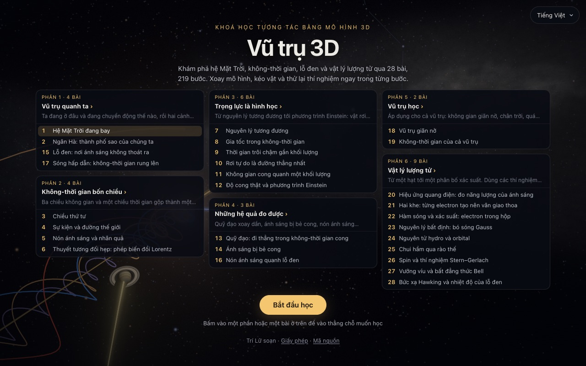
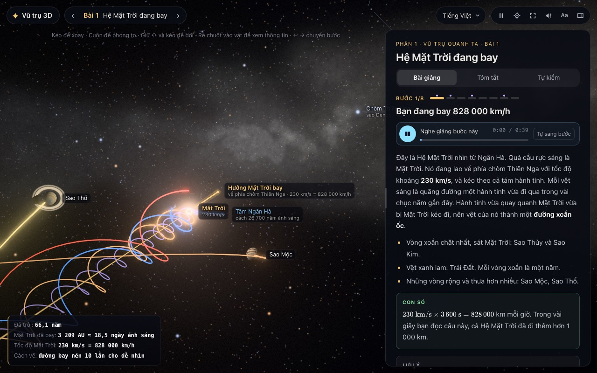
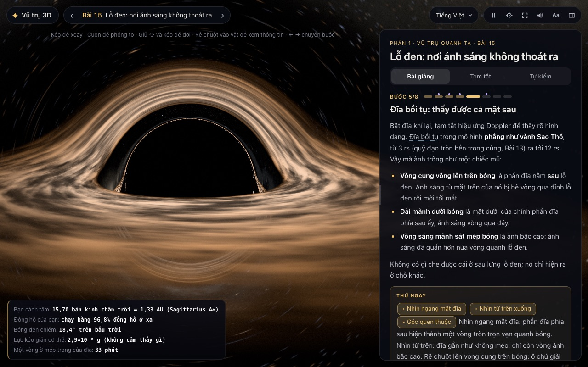
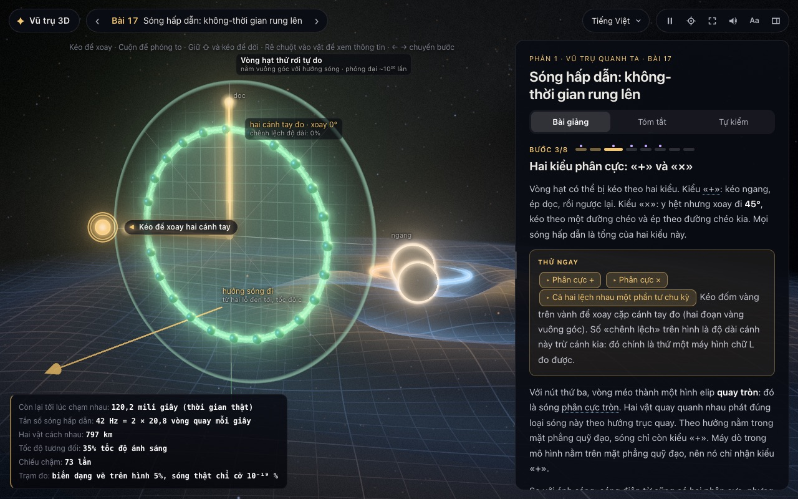
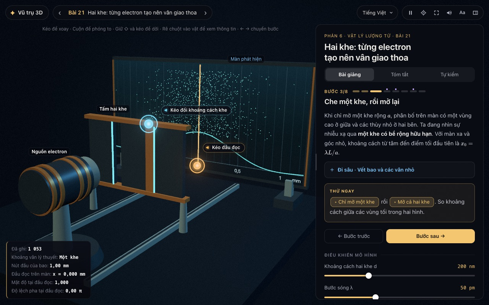

# Vũ trụ 3D

**Tiếng Việt** · [English](README.en.md) · [简体中文](README.zh-CN.md) · [日本語](README.ja.md)

Khoá học vật lý bằng mô hình 3D tương tác: hệ Mặt Trời, không-thời gian, thuyết tương đối, lỗ đen, sóng hấp dẫn, vũ trụ học và vật lý lượng tử. 28 bài, bốn thứ tiếng (Việt, Anh, Trung giản thể, Nhật). Mỗi bài là một mô hình chạy thật trên trình duyệt, kèm lời giảng chia thành từng bước: đọc tới đâu, mô hình đổi tới đó. Bạn xoay, phóng to, kéo vật, đổi thông số và làm lại thí nghiệm ngay trong bài.

**Dùng ngay trên web: <https://trilu.edu.vn/vu-tru-3d/>**. Không cần cài đặt, không cần tài khoản.



| | |
|---|---|
|  |  |
|  |  |

## Nội dung

Sáu phần, 28 bài. Số bài giữ cố định (lời giảng nhắc nhau bằng số này), còn thứ tự hiển thị đưa hai bài ngoạn mục nhất lên đầu.

**Phần 1 · Vũ trụ quanh ta**
1. Hệ Mặt Trời đang bay
2. Ngân Hà: thành phố sao của chúng ta
15. Lỗ đen: nơi ánh sáng không thoát ra
17. Sóng hấp dẫn: không-thời gian rung lên

**Phần 2 · Không-thời gian bốn chiều**
3. Chiều thứ tư
4. Sự kiện và đường thế giới
5. Nón ánh sáng và nhân quả
6. Thuyết tương đối hẹp: phép biến đổi Lorentz

**Phần 3 · Trọng lực là hình học**
7. Nguyên lý tương đương
8. Gia tốc trong không-thời gian
9. Thời gian trôi chậm gần khối lượng
10. Rơi tự do là đường thẳng nhất
11. Không gian cong quanh một khối lượng
12. Độ cong thật và phương trình Einstein

**Phần 4 · Những hệ quả đo được**
13. Quỹ đạo: đi thẳng trong không-thời gian cong
14. Ánh sáng bị bẻ cong
16. Nón ánh sáng quanh lỗ đen

**Phần 5 · Vũ trụ học**
18. Vũ trụ giãn nở
19. Không-thời gian của cả vũ trụ

**Phần 6 · Vật lý lượng tử**
20. Hiệu ứng quang điện: đo năng lượng của ánh sáng
21. Hai khe: từng electron tạo nên vân giao thoa
22. Hàm sóng và xác suất: electron trong hộp
23. Nguyên lý bất định: bó sóng Gauss
24. Nguyên tử hydro và orbital
25. Chui hầm qua rào thế
26. Spin và thí nghiệm Stern–Gerlach
27. Vướng víu và bất đẳng thức Bell
28. Bức xạ Hawking và nhiệt độ của lỗ đen

Mỗi bài có ba thẻ: **Bài giảng** (các bước, có nút «thử ngay» điều khiển mô hình), **Tóm tắt** (ý chính, con số đáng nhớ, điều hay hiểu sai) và **Tự kiểm** (câu hỏi có đáp án giải thích). Số liệu trong bài lấy từ nguồn đo đạc và bài báo được ghi ngay trong bài. Bài 1 đã có giọng đọc lời giảng tiếng Việt; các bài khác đang được thu dần.

<details>
<summary><b>Phím tắt</b></summary>

| Phím | Việc |
|---|---|
| ← → | bước trước, bước sau |
| ⇧← ⇧→ (hoặc PageUp, PageDown) | bài trước, bài sau |
| Phím cách | tạm dừng hoặc chạy tiếp mô hình |
| R | về góc nhìn ban đầu |
| F | toàn màn hình |
| B | ẩn hoặc hiện bảng bài giảng |
| M | mục lục |
| G | sổ tay thuật ngữ và công thức |
| N | nghe giảng bước đang mở (khi bước có giọng đọc) |
| S | bật hoặc tắt tiếng |
| Esc | đóng mục lục, sổ tay |
| Enter | (ở màn hình chào) vào học |

Chuột: kéo để xoay, cuộn để phóng to, giữ ⇧ và kéo để dời; rê chuột vào vật để xem thông tin. Trên điện thoại: một ngón để xoay, hai ngón để phóng to và dời.

Mở thẳng một chỗ bằng đường dẫn: `?bai=15` (theo số bài), `?canh=lo-den&buoc=3` (theo mã bài và số bước), `?lang=en` (thứ tiếng: `vi`, `en`, `zh-CN`, `ja`).

</details>

<details>
<summary><b>Dành cho người lập trình: dựng từ mã nguồn, cấu trúc thư mục, thêm một bài, giọng đọc</b></summary>

## Dựng từ mã nguồn

Cần Node.js 18 trở lên.

```bash
npm install          # cài three.js, KaTeX, esbuild… (chỉ dùng lúc dựng)
npm run build        # → dist/index.html: một tệp HTML tự chứa, bấm đúp là mở, không cần mạng
npm run web          # → dist/web/: bản để đặt lên máy chủ web, kèm tệp giọng đọc, biểu tượng, thẻ chia sẻ
npm run kiem         # chạy các bộ kiểm số liệu vật lý (không cần trình duyệt)
```

`dist/index.html` chạy được ngay từ ổ đĩa nhưng không có giọng đọc (tệp tiếng nằm ngoài trang). Muốn thử bản web tại máy:

```bash
python3 -m http.server 8000 -d dist/web     # rồi mở http://localhost:8000/
```

Hoặc để máy tự thử (Chrome ẩn, tắt tiếng; trang đặt dưới `/vu-tru-3d/`, bốn thứ tiếng, máy tính và điện thoại, thanh nghe giảng): `node cong-cu/thu-ban-web.mjs dist/web`.

Bản web dùng đường dẫn tương đối nên đặt dưới thư mục con nào cũng chạy (ví dụ `/vu-tru-3d/`). Địa chỉ dùng cho thẻ chia sẻ đổi bằng `node cong-cu/dung-web.mjs --goc-web https://ten-mien-cua-ban/duong-dan/`.

Vài tuỳ chọn của `build.mjs`:

```bash
node build.mjs --tho                         # không nén, dễ dò lỗi
node build.mjs --chi lo-den,song-hap-dan     # chỉ đóng gói vài bài (dựng nhanh)
node build.mjs --ra "Dữ liệu làm việc/thu"   # ghi ra thư mục khác thay cho dist/
```

### App Mac

Trên macOS có Xcode Command Line Tools (`xcode-select --install`):

```bash
bash dong-goi-app.sh            # dựng trang, biên dịch vỏ app (Swift + WKWebView), cài vào ~/Applications
bash dong-goi-app.sh --kiem     # dựng xong cho app tự đi qua mọi bài; chỉ cài khi không có lỗi
```

App được ký tạm tại máy (ad-hoc), chưa công chứng với Apple, nên chỉ dùng trên máy tự dựng.

### Kiểm bằng trình duyệt chạy ẩn

Cần Google Chrome. Các lệnh dưới chạy Chrome ẩn, tắt tiếng.

```bash
bash kiem-tra/tu-kiem.sh dist/index.html                    # trang tự đi qua mọi bước, bấm mọi nút «thử ngay», báo lỗi
bash kiem-tra/chup.sh dist/index.html anh.png "canh=lo-den&buoc=3&tua=4"   # chụp một bước để xem hình
```

`tua=4` cho mô hình chạy trước 4 giây rồi mới chụp (trình duyệt chạy ẩn gần như không cho hoạt hình chạy).

## Cấu trúc thư mục

```
src/
  main.js, index.html, style.css   khởi động, khung trang, kiểu chữ
  khung/        phần dùng chung: vòng vẽ, bảng bài giảng, giao diện, âm thanh tổng hợp, tương tác, dựng hình
  canh/         mỗi bài một tệp <mã bài>.js: mô hình 3D và lời giảng tiếng Việt
  vat-ly/       tính toán vật lý thuần (không vẽ), có bộ kiểm riêng
  noi-dung/     danh mục khoá học, lời đọc, thuật ngữ, lời giảng các bài lượng tử
  ngon-ngu/     bản dịch tiếng Anh, Trung, Nhật (mỗi bài một tệp JSON) và bộ chọn thứ tiếng
  du-lieu/      dữ liệu bầu trời đã đóng gói (sao, dải Ngân Hà, chòm sao)
app-mac/        vỏ app Mac (Swift) và biểu tượng
giong-doc/      tệp giọng đọc lời giảng và danh sách của chúng
cong-cu/        dựng bản web, tạo giọng đọc, tách chữ để dịch, đóng gói dữ liệu bầu trời
kiem-tra/       bộ kiểm số liệu (kiem-*.mjs), tự kiểm và chụp ảnh bằng Chrome ẩn
tai-lieu/anh/   ảnh trong README
tai-nguyen-web/ biểu tượng trang và ảnh chia sẻ của bản web
build.mjs       đóng gói mọi thứ thành một tệp HTML
```

## Thêm một bài

1. Tạo `src/canh/<mã-bài>.js`, xuất mặc định một đối tượng:

   ```js
   export default {
     id: 'ma-bai',                 // trùng tên tệp
     ten: 'Tên bài',
     moTa: 'Một dòng hiện trong mục lục',
     yChinh: 'Hai ba câu tóm ý chính (thẻ Tóm tắt)',
     mayAnh: { viTri: [12, 10, 14], dich: [0, 0, 0], fov: 40, min: 4, max: 70 },
     baiGiang: { mucTieu, buoc, congThuc, cauHoi, docThem, thuatNgu },
     conSo: ['**299 792,458 km/s**: …'],
     hieuDung: '…',
     nguon: 'Nguồn số liệu …',
     tao(app) {
       const scene = new THREE.Scene();
       // dựng hình; thêm thanh trượt, nút… bằng app.bang
       return { scene, capNhat(dt) {}, hud() { return [['Nhãn', 'giá trị']]; } };
     },
   };
   ```

   Mỗi bước trong `baiGiang.buoc` có `ten`, `noiDung` (chữ có đánh dấu, xem dưới) và hàm `vao(canh, app)` đặt mô hình về trạng thái của bước.
2. Thêm mã bài vào `SO_BAI` (số bài) và vào một phần trong `KHOA_HOC` ở `src/noi-dung/khoa-hoc.js`.
3. Chữ có đánh dấu trong lời giảng (xem đầu tệp `src/khung/bai-giang.js`): `**đậm**`, `*nhấn*`, `$công thức$`, `$$công thức đứng riêng$$`, `### tiêu đề nhỏ`, gạch đầu dòng, bảng, hộp `> [Ví dụ] …`, khối gập `+++ Đi sâu: …`, nút `[[Nhãn|tên-hàm]]` gọi `nut.<tên-hàm>` của bước, thuật ngữ `{{tên thuật ngữ}}`.
4. Phần tính toán vật lý đặt ở `src/vat-ly/`, kèm bộ kiểm `kiem-tra/kiem-<mã-bài>.mjs` (dùng `kiem-tra/khung-kiem.mjs`).
5. Bản dịch: `node cong-cu/xuat-chu-bai.mjs` tách chữ tiếng Việt ra `src/ngon-ngu/vi/`; bản dịch đặt cùng tên tệp trong `src/ngon-ngu/en/`, `zh-CN/`, `ja/`. Chuỗi chưa dịch thì trang hiện tiếng Việt.
6. Dựng riêng bài mới cho nhanh: `node build.mjs --tho --chi ma-bai`, rồi `bash kiem-tra/tu-kiem.sh dist/index.html "canh=ma-bai&tukiem=1"` và chụp ảnh từng bước để tự xem.

## Giọng đọc

Lời đọc của từng bước nằm trong `src/loi-doc/vi/*.json`. Tệp tiếng tạo bằng `cong-cu/tao-giong-doc-google.py` (dịch vụ Google Cloud Text-to-Speech, giọng Chirp 3 HD; cần tài khoản Google Cloud của riêng bạn, `gcloud`, FFmpeg). Công cụ chỉ tạo lại bước nào lời đã đổi và ghi `giong-doc/danh-sach.json`; trang đọc danh sách này lúc dựng.

</details>

## Báo lỗi, góp ý

Mở một [issue](https://github.com/luminhtri0-hash/vu-tru-3d/issues) và ghi: bài số mấy, bước số mấy, thứ tiếng, trình duyệt và máy (máy tính hay điện thoại), ảnh chụp màn hình nếu có. Sai về vật lý hoặc số liệu thì xin kèm nguồn. Có thể sửa thẳng và gửi pull request; với bài mới, nên mở issue bàn trước.

## Ghi công và giấy phép

Trí Lữ soạn bài, viết mã và dựng mô hình.

- **Mã nguồn**: giấy phép MIT, xem [`LICENSE`](LICENSE).
- **Nội dung học** (lời giảng, lời đọc, bản dịch, tệp giọng đọc, hình ảnh): CC BY-NC-SA 4.0, xem [`LICENSE-CONTENT.md`](LICENSE-CONTENT.md) để biết chính xác tệp nào thuộc phần này. Dạy học, chiếu trên lớp, dịch để dùng phi thương mại thì cứ dùng, nhớ ghi công.
- **Thư viện, phông chữ, dữ liệu của bên thứ ba** (three.js, KaTeX, dữ liệu sao Hipparcos/XHIP, bờ biển Natural Earth…): xem [`NOTICE.md`](NOTICE.md).

© 2026 Trí Lữ.
