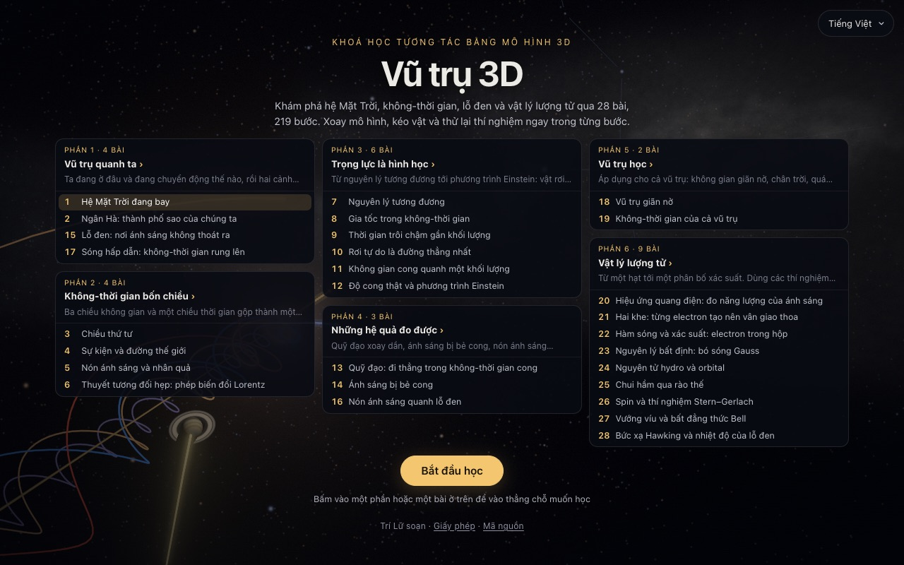
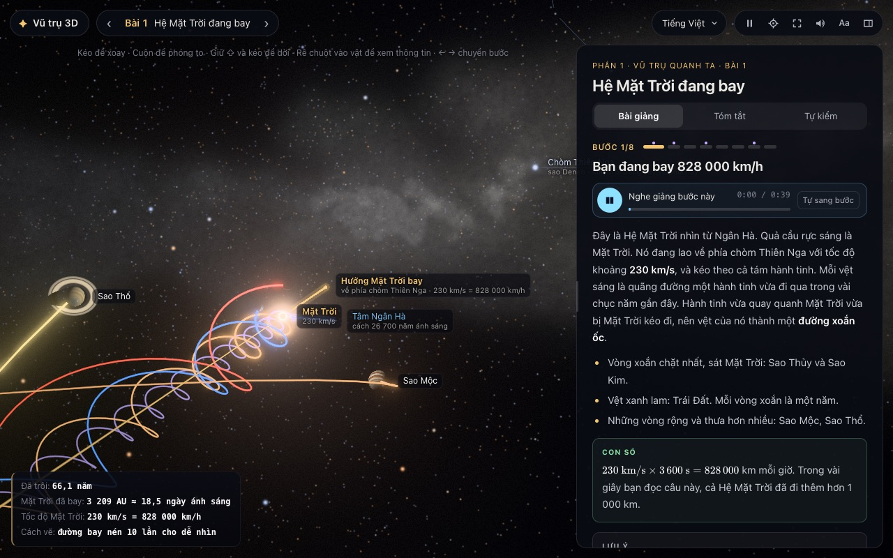
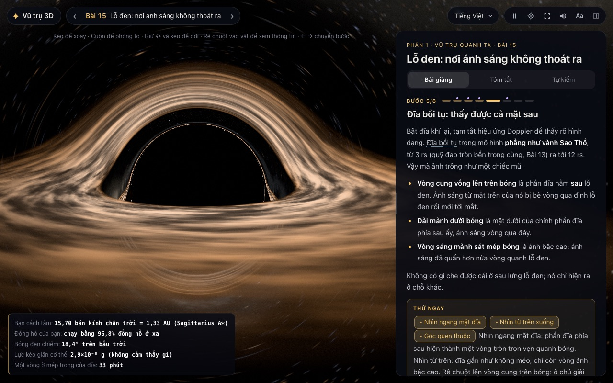
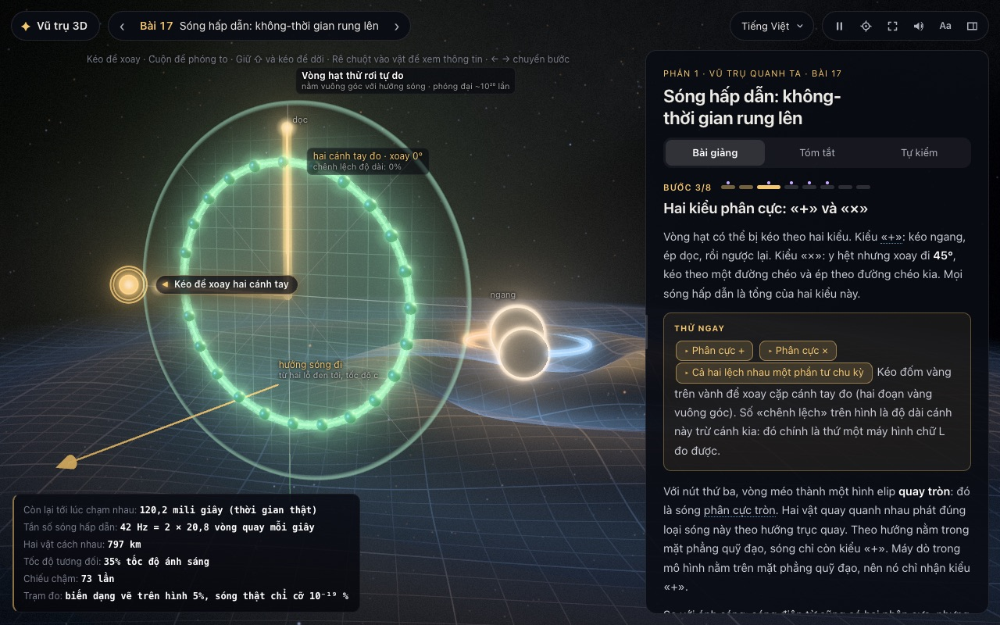
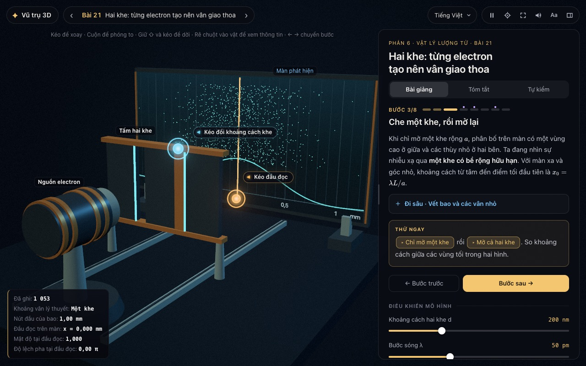

# 3D宇宙（Vũ trụ 3D）

[Tiếng Việt](README.md) · [English](README.en.md) · **简体中文** · [日本語](README.ja.md)

一门用互动3D模型来学的物理课：太阳系、时空、狭义与广义相对论、黑洞、引力波、宇宙学和量子物理。共28课，提供越南语、英语、简体中文和日语四种语言。每一课都是在浏览器里实时运行的模型，配有分步讲解：读到哪一步，模型就演示到哪一步。你可以旋转、缩放、拖动物体、调参数，在课里反复做实验。

**直接在线使用：<https://trilu.edu.vn/vu-tru-3d/>** 无需安装，无需注册。



| | |
|---|---|
|  |  |
|  |  |

## 课程内容

六个部分，28课。课号固定不变（讲解里会用课号互相引用），目录里把最精彩的两课放到了前面。

- **第1部分 · 我们周围的宇宙**：1 飞行中的太阳系 · 2 银河系：我们的恒星之城 · 15 黑洞：连光也逃不出的地方 · 17 引力波：时空的振动
- **第2部分 · 四维时空**：3 第四维 · 4 事件与世界线 · 5 光锥与因果关系 · 6 狭义相对论：洛伦兹变换
- **第3部分 · 引力的几何本质**：7 等效原理 · 8 时空中的加速度 · 9 质量附近时间变慢 · 10 自由下落是最直的路 · 11 质量周围的弯曲空间 · 12 真正的曲率与爱因斯坦方程
- **第4部分 · 可以测量的效应**：13 轨道：在弯曲时空中走直线 · 14 光线弯曲 · 16 黑洞周围的光锥
- **第5部分 · 宇宙学**：18 膨胀的宇宙 · 19 整个宇宙的时空
- **第6部分 · 量子物理**：20 光电效应：测量光的能量 · 21 双缝实验：电子逐个到达，干涉条纹逐渐形成 · 22 波函数与概率：箱中的电子 · 23 不确定性原理：高斯波包 · 24 氢原子与轨道 · 25 穿过势垒的隧穿 · 26 自旋与斯特恩–盖拉赫实验 · 27 纠缠与贝尔不等式 · 28 霍金辐射与黑洞温度

每课有三个页签：**课程讲解**（分步讲解，“动手试试”按钮会直接操作模型）、**小结**（要点、值得记住的数字、常见误解）和**自测**（附详细解答的题目）。课中的数据都来自课里注明的观测和论文。第1课已有越南语配音，其他课正在陆续录制。有几课（目前是第10–14、16、18、19课）还在翻译中，暂时显示越南语原文。

## 快捷键

| 按键 | 作用 |
|---|---|
| ← → | 上一步 / 下一步 |
| ⇧← ⇧→（或 PageUp / PageDown） | 上一课 / 下一课 |
| 空格 | 暂停或继续模型 |
| R | 回到初始视角 |
| F | 全屏 |
| B | 显示或隐藏讲解面板 |
| M | 课程目录 |
| G | 术语与公式手册 |
| N | 播放本步配音（有配音时） |
| S | 打开或关闭声音 |
| Esc | 关闭目录、手册 |
| Enter | （欢迎页）开始学习 |

鼠标：拖动旋转，滚轮缩放，按住 ⇧ 拖动平移，把鼠标移到物体上可查看信息。手机上：单指旋转，双指缩放和平移。

链接参数：`?bai=15`（按课号）、`?canh=lo-den&buoc=3`（按课程代号和步数）、`?lang=zh-CN`（可选 `vi`、`en`、`zh-CN`、`ja`）。

## 从源码构建

需要 Node.js 18 或更高版本。

```bash
npm install          # 安装 three.js、KaTeX、esbuild 等（只在构建时用）
npm run build        # → dist/index.html：单个自包含的 HTML 文件，双击即可打开，离线可用
npm run web          # → dist/web/：放到网站服务器上的版本，含配音文件、图标和分享标签
npm run kiem         # 运行物理数据的测试（不需要浏览器）
```

`dist/index.html` 可以直接从磁盘打开，但没有配音（音频文件不在页面里）。想在本机试网页版：

```bash
python3 -m http.server 8000 -d dist/web     # 然后打开 http://localhost:8000/
```

网页版只用相对路径，放在任何子目录下都能运行（比如 `/vu-tru-3d/`）。分享标签里的网址可以这样改：`node cong-cu/dung-web.mjs --goc-web https://你的域名/路径/`。

`build.mjs` 的常用选项：`--tho`（不压缩，便于调试）、`--chi lo-den,song-hap-dan`（只打包部分课程，构建更快）、`--ra <目录>`（输出到 `dist/` 以外的目录）。

### macOS 应用

装好 Xcode Command Line Tools（`xcode-select --install`）后：

```bash
bash dong-goi-app.sh            # 构建页面，编译 Swift + WKWebView 外壳，安装到 ~/Applications
bash dong-goi-app.sh --kiem     # 构建后让应用自动走完每一课，没有错误才安装
```

应用只做了本机临时签名（ad-hoc），没有经过 Apple 公证，只适合在构建它的那台电脑上用。

### 用无界面浏览器检查

需要 Google Chrome，以无界面、静音方式运行。

```bash
bash kiem-tra/tu-kiem.sh dist/index.html                                    # 自动走完每一步、按下每个按钮，报告错误
bash kiem-tra/chup.sh dist/index.html shot.png "canh=lo-den&buoc=3&tua=4"   # 给某一步截图
```

`tua=4` 表示先让模型运行4秒再截图（无界面浏览器几乎不播放动画）。

## 目录结构

代码用越南语编写：文件、目录和大多数标识符是不带声调的越南语词（`canh` = 场景/课，`khung` = 框架，`vat-ly` = 物理，`ngon-ngu` = 语言，`kiem-tra` = 测试，`cong-cu` = 工具，`giong-doc` = 配音）。

```
src/
  main.js, index.html, style.css   启动、页面骨架、样式
  khung/        公共框架：渲染循环、讲解面板、界面、合成音效、交互、渲染
  canh/         每课一个文件 <课程代号>.js：3D模型和越南语讲解
  vat-ly/       纯物理计算（不绘图），各有测试
  noi-dung/     课程目录、配音稿、术语表、量子部分各课的讲解
  ngon-ngu/     英、中、日译文（每课一个 JSON 文件）和语言选择器
  du-lieu/      打包好的星空数据（恒星、银河、星座）
app-mac/        macOS 外壳（Swift）和图标
giong-doc/      讲解配音及其索引
cong-cu/        构建网页版、生成配音、为翻译提取文字、打包星空数据
kiem-tra/       物理测试（kiem-*.mjs）、用无界面 Chrome 自测和截图
tai-lieu/anh/   README 用的图片
tai-nguyen-web/ 网页版的图标和分享图
build.mjs       把一切打包成一个 HTML 文件
```

## 添加一课

1. 新建 `src/canh/<课程代号>.js`，默认导出一个对象，包含 `id`、`ten`（标题）、`moTa`（一行简介）、`yChinh`（要点）、`mayAnh`（相机）、`baiGiang`（讲解：`mucTieu`、`buoc`、`congThuc`、`cauHoi`、`docThem`、`thuatNgu`）、`conSo`、`hieuDung`、`nguon`（出处），以及 `tao(app)`：搭建场景并返回 `{ scene, capNhat(dt), hud() }`。`baiGiang.buoc` 中每一步有 `ten`、`noiDung`（带标记的文字）和 `vao(场景, app)`，用来把模型设到这一步的状态。照着任何一课改就行。
2. 在 `src/noi-dung/khoa-hoc.js` 里把代号加进 `SO_BAI`（课号）和 `KHOA_HOC` 的某个部分。
3. 讲解的标记写法（见 `src/khung/bai-giang.js` 开头）：`**粗体**`、`*强调*`、`$行内公式$`、`$$独立公式$$`、`### 小标题`、列表、表格、提示框 `> [Ví dụ] …`、折叠块 `+++ Đi sâu: …`、按钮 `[[文字|名称]]`（调用该步的 `nut.<名称>`）、术语 `{{术语}}`。
4. 物理计算放在 `src/vat-ly/`，并写测试 `kiem-tra/kiem-<课程代号>.mjs`（用 `kiem-tra/khung-kiem.mjs`）。
5. 翻译：`node cong-cu/xuat-chu-bai.mjs` 把越南语文字提取到 `src/ngon-ngu/vi/`；译文以同名文件放在 `src/ngon-ngu/en/`、`zh-CN/`、`ja/`。没翻译的句子会显示越南语原文。
6. 只构建新课会快很多：`node build.mjs --tho --chi <课程代号>`，然后 `bash kiem-tra/tu-kiem.sh dist/index.html "canh=<课程代号>&tukiem=1"`，再逐步截图看效果。

## 配音

每一步的配音稿在 `src/noi-dung/loi-doc.js`。音频用 `cong-cu/tao-giong-doc-google.py` 生成（Google Cloud Text-to-Speech 的 Chirp 3 HD 语音；需要你自己的 Google Cloud 项目、`gcloud` 和 FFmpeg）。只会重新生成文字改过的步骤，并更新 `giong-doc/danh-sach.json`；构建页面时会读取这个索引。

## 报告问题与建议

请提交 [issue](https://github.com/luminhtri0-hash/vu-tru-3d/issues)，写明第几课、第几步、使用的语言、浏览器和设备，最好附截图。物理或数据有误时，附上出处会很有帮助。欢迎 pull request；想加新课的话，请先开 issue 讨论。

## 署名与许可

课程、代码和模型由 Trí Lữ 制作。

- **源代码**：MIT 许可，见 [`LICENSE`](LICENSE)。
- **课程内容**（讲解、配音稿、译文、配音音频、图片）：CC BY-NC-SA 4.0，具体包括哪些文件见 [`LICENSE-CONTENT.md`](LICENSE-CONTENT.md)。教学、课堂放映、为非商业用途翻译都可以，请注明出处。
- **第三方库、字体和数据**（three.js、KaTeX、Hipparcos/XHIP 恒星数据、Natural Earth 海岸线等）：见 [`NOTICE.md`](NOTICE.md)。

© 2026 Trí Lữ.
